# Этап 1: модель данных Thai CRM

8 октября 2026. Это спецификация и проверяемый DDL-прототип, не подключённая
схема приложения. Действующая БД, runtime и Alembic не переключаются на этом этапе.

Файлы: [SQL](schema_draft.sql), [правила операций](POSTING_RULES.md),
[решения и открытые вопросы](DECISIONS.md), [карта требований](REQUIREMENTS.md).

## 1. Предметные границы и SOLID

| Контекст | Объекты и ответственность | Что ему не принадлежит |
|---|---|---|
| Identity | Party, Client, ClientGroup, TelegramLink, Operator | Балансы и проведение денег |
| Finance | Instrument, Money, FxQuote, PostingPlan, FinancialOperation | Формы расходов и Telegram |
| Inventory | InventoryPosition, WeightedAverageCostPolicy | Процент инвестора, доля прибыли |
| Capital | CapitalAgreement, InterestTerm, ContributionLot, FifoWithdrawalPlan | Клиентские кошельки и займы |
| Distributions | InterestAccrual, DistributionPayment, PaymentAllocation | Капитал и касса как независимые балансы |
| Wallets | ClientWallet, WalletTransfer | Отдельный реестр заёмных денег |
| Expenses | Expense, ExpenseSharePolicy, ExpenseObligation, Resolution, Statement | Автоматическое списание Данияра |
| Profit | ProfitStatement, ProfitShareTerm, OwnerAccrual | Возврат капитала и основного долга |
| BestChange | BestChangeCalculation, PeriodTransfer | Собственный независимый денежный журнал |

В реализации использовать композицию, immutable value objects и узкие `Protocol`,
а не общий класс «менеджер всех финансов». Предлагаемая структура:

```text
domain/finance/          Money, InstrumentCode, FxQuote, PostingPlan, LedgerSide
domain/capital/          ContributionLot, FifoPolicy, InterestTerms
domain/expenses/         SharePolicy, Obligation, SettlementPlan
services/finance/        OperationPostingService, ReversalService, узкие порты
services/capital/        ContributeCapital, WithdrawCapital, AccrueInterest
services/expenses/       RecordExpense, SettleExpense, CloseExpensePeriod
api/queries/            объединение read-моделей, без финансовых изменений
db_asyncpg/...          реализация persistence ports и блокировок
app/container.py        единственная сборка зависимостей
```

SRP: калькулятор определяет суммы, use case оркестрирует операцию, repository
сохраняет, presenter форматирует. OCP: новый вид документа предоставляет PostingPlan
общему сервису проведения; не добавлять цепочку `if kind` в универсальный repository.
LSP: все реализации порта сохраняют контракт идемпотентности, Decimal и транзакции.
ISP: read/write/lock ports разделены; query займов не зависит от капитала.
DIP: domain не импортирует asyncpg/FastAPI/aiogram; сервисы получают порты через DI.

DRY: одно правило курса, округления, проведения, сторно и outbox. Одно хранение
ставки инвестора — `capital_interest_terms.monthly_interest_percent`; API договора
показывает её по бизнес-дате. Не дублировать «текущую ставку» отдельным редактируемым
полем `capital_agreements`: это создало бы два источника одного значения.
Снимки закрытий и восстанавливаемые проекции допустимы: это явно производные данные.
Не создавать наследование всех финансовых документов от большой модели с необязательными полями.

## 2. Связи

```mermaid
erDiagram
    parties ||--o{ party_roles : roles
    parties ||--o| clients : identity
    client_groups ||--o{ clients : classification
    clients ||--o{ client_chat_links : chats
    clients ||--o{ client_wallet_accounts : wallets
    ledger_accounts ||--o| client_wallet_accounts : balance
    ledger_accounts ||--o| cash_accounts : cash
    financial_operations ||--o{ journal_lines : posts
    ledger_accounts ||--o{ journal_lines : entries
    currencies ||--o{ instruments : forms
    parties ||--o{ capital_agreements : invests
    capital_agreements ||--o{ capital_interest_terms : rates
    capital_agreements ||--o{ capital_contributions : lots
    capital_agreements ||--o{ capital_withdrawals : withdrawals
    capital_withdrawals ||--o{ capital_withdrawal_allocations : consumes
    capital_contributions ||--o{ capital_withdrawal_allocations : fifo
    capital_agreements ||--o{ investor_interest_accruals : interest
    distribution_payments ||--o{ investor_interest_payment_allocations : pays
    investor_interest_accruals ||--o{ investor_interest_payment_allocations : allocated
    expenses ||--o{ expense_share_inputs : inputs
    expenses ||--o{ expense_allocations : final_shares
    expenses ||--o{ expense_obligations : debts
    expense_resolutions ||--o{ expense_resolution_allocations : resolves
    expense_obligations ||--o{ expense_resolution_allocations : cleared
    expense_period_closures ||--o{ expense_statement_rows : snapshots
    deals ||--o{ deal_legs : exchange
    deals ||--o| best_change_calculations : calculation
    best_change_period_transfers ||--o{ best_change_transfer_allocations : closes
    profit_period_closures ||--o{ partner_profit_accruals : distributes
    distribution_payments ||--o{ partner_profit_payment_allocations : pays
```



## 3. Словарь данных

SQL описывает каждую колонку, тип, PK/FK и локальные ограничения. Ниже — смысл
полей, которые нельзя трактовать по-разному в разных сервисах.

| Сущность / поле | Значение |
|---|---|
| `parties.id` | Устойчивая идентичность человека/организации; имя не является ключом |
| `business_participants.code` | Привязки business/skyex/pe/daniyar; ни имена, ни Telegram ID не hardcode |
| `business_client_bindings.purpose` | Явная привязка клиента «Баланс Данияр» и клиента чата сделок BestChange |
| `clients.group_code` | Классификация; `partner` отображается в займах, `balance` сам по себе нет |
| `client_wallet_accounts.kind` | `client` — обычный кошелёк; `profit_buffer` — кошелёк чата BestChange |
| `ledger_accounts.party_id` | Экономический владелец обязательства; буфер BestChange относится к Данияру |
| `instruments.code` | Конкретный независимый остаток денег |
| `currency_code` | Валюта суммы; THB_CASH/THB_BANK имеют одну валюту THB |
| `financial_operations.posting_mode` | `ledger` — меняет книгу фирмы; `memorandum` — только управленческий документ |
| `business_date` / `effective_at` / `recorded_at` | День учёта / момент операции / время регистрации; не взаимозаменяемы |
| `idempotency_key` / `command_hash` | Уникальный запрос / хэш канонизированных параметров для проверки повтора |
| `reversal_of_id` | Одна компенсирующая операция на исходную; источник остаётся immutable |
| `journal_lines.native_amount` | Неотрицательный модуль суммы в валюте счёта; знак задаётся debit/credit |
| `journal_lines.amount_usdt` | Учётная стоимость той же строки; при валютном результате количество может быть 0 |
| `valuation_basis` | Rate snapshot / средняя carrying cost / историческая оценка / базовая USDT |
| `account_balances` | Кэш знаковых дебетовых сумм; при кредитовом счёте отображение инвертируется |
| `inventory_*` | Стоимость/количество тех же кассовых активов; не второй набор активов фирмы |
| `capital_interest_terms.monthly_interest_percent` | Месячная ставка в процентах: 2 = 2%; источник ставки для API оборотки |
| `capital_agreements.principal_kind` | Капитал собственника или обязательство стороннему инвестору; фиксируется для договора |
| `capital_principal_accounts` | Счёт principal на договор и исходную валюту; общий principal USDT суммируется в отчёте |
| `valid_from` / `valid_until` | Интервал [from, until), без пересечений по договору |
| `capital_contributions.principal_usdt` | Историческая оценка исходного капитала партии, не рыночная переоценка |
| `source_quantity` | Часть исходного вклада, списанная FIFO; не обязательно текущая кассовая себестоимость |
| `basis_usdt`, `term_id`, `calculated_usdt` | База начисления, версия ставки и расчёт до ручной корректировки |
| `adjustment_usdt` / `adjustment_reason` | Решение менеджера для неполного месяца; обязательная причина изменения |
| `distribution_payments.discharged_usdt` | Погашенное начисление, отдельно от физического количества выдачи |
| `expense_share_inputs` | Исходные 4 поля формы; `common` означает распределение между собственниками |
| `expense_allocations` | Финальные доли Данияр/ПЕ/SkyEX после раскрытия common |
| `expense_obligations.business_ledger_account_id` | Только требование, в котором участвует фирма; внешние личные долги не её активы |
| `expense_resolutions` | Платёж или взаимозачёт; один алгоритм распределений вместо двух несовместимых реестров |
| `expense_statement_rows` | Неизменяемый снимок месяца по паре участников и валюте |
| `best_change_calculations.pricing_currency` | THB для этой CRM; исходные client/market rates — THB/USDT |
| `buffer_wallet_account_id` | Кошелёк чата BestChange, куда начислена часть Данияра до закрытия |
| `best_change_period_transfers` | Перенос из буфера в «Баланс Данияр», с привязками к сделкам периода |
| `profit_share_terms` | Договорённость ПЕ/SkyEX, отдельно от ставки на капитал |
| `profit_period_closures` | Зафиксированный состав прибыли; выплаты не меняют исторический результат |
| `telegram_outbox` | Сообщения после commit, отдельные retries/leases; не источник финансового результата |

## 4. Валюты, точность и алиасы

| Инструмент | Валюта | Точность v 1 | Основные входные алиасы |
|---|---|---|---|
| THB_CASH | THB | 2 | thb, бат, батнал |
| THB_BANK | THB | 2 | thbb, батбезнал |
| USDT | USDT | 6 | usdt, юсдт |
| USD_WH | USD | 2 | usdw, usd_wh, долбел |
| USD_BL | USD | 2 | usd, usdb, usdbl, usd_bl, долсин |
| EUR | EUR | 2 | eur, евро |
| EUR500 | EUR | 2 | eur 500, евро 500 |
| RUB | RUB | 2 | rub, руб |

Decimal, ROUND_HALF_UP; количества хранятся с запасом 8 знаков, расчёт стоимости
USDT с 8, API показывает точность инструмента. Курс нормализуется с 18 знаками.
Фиатная точность не означает проверку реальных номиналов банкнот в первой версии.
Неоднозначный `thb` означает наличный бат; явный alias нужен для банковского.
Сервис отвергает лишние знаки в введённом количестве, вместо незаметного округления суммы.

Для THB: Q = THB за 1 USDT, стоимость = amount / Q. Для остальных: R = USDT за
единицу, стоимость = amount × R. Для USDT Q=R=1. Не использовать float.
Участники расхода получают целые минимальные единицы валюты методом наибольших
остатков: floor каждой доли, остаток по убыванию дроби, при равенстве стабильный party ID.
Последняя часть FIFO погашает точный остаток стоимости партии, чтобы не оставить копейки.

## 5. Источник балансов и обязательств

Положительный кошелёк — долг обменника клиенту, кредитовый ledger-счёт.
Отрицательный — долг клиента обменнику; хранить знак и не показывать abs как заём.
`partner_loan_balances` — SQL view тех же счетов группы partner, включая нулевые.
API по умолчанию может скрывать нули (`includeZero=false`), фильтр sign отдельно.
Итоги положительных обязательств и отрицательных требований отдельные.
Все суммы займов уже входят в клиентскую категорию: главная не складывает их второй раз.
Буфер BestChange входит в соответствующее обязательство Данияру один раз, несмотря
на служебный тип кошелька. Смена группы/чата не создаёт денежных проводок.

Средняя стоимость применяется к физическим кассовым активам, включая поступившие
от клиентов деньги. Любое поступление фиксирует стоимость актива и соответствующего
обязательства/капитала. Любой реальный вывод уменьшает актив и его стоимость.
Обмен внутри кошелька меняет валюты обязательства, а не физические остатки кассы;
его валютный результат учитывается в операции обмена, а не при произвольном изменении статуса.

Знак дебетовых сумм для счетов активов и расходов положительный, кредитовых —
для капитала, обязательств и доходов. Не смешивать эту техническую конвенцию
со знаком клиентского UI без нормализации через normal_side.

## 6. Капитал и проценты

Оборотка хранит договор и партии. Для процента в UI выполняется запрос версии
условий на бизнес-дату. В закрытом начислении FK `term_id` указывает на неизменную
версию ставки. ПЕ/SkyEX имеют ставку 0%; прибыль собственников — другой контекст.

Возврат v 1 только исходной валютой. FIFO выбирает партии договора этой валюты по
`operation.business_date`, `effective_at`, ID. Если вклад в THB_CASH, выдача THB_BANK
сохраняет валюту THB; источник физической кассы указывается отдельно. Разные формы
USD/EUR сохраняются как инструменты; в v1 смена формы USD/EUR при возврате запрещена.
Конвертация USD→THB для возврата капитала в v 1 отклоняется.

Сумма погашаемого капитала определяется старым курсом. Стоимость физически
выданной валюты списывается по средней себестоимости кассы. Их возможная разница
проводится отдельно как валютный результат, а не подменяет старый курс партии.
Классификация этой разницы в отчёте описана в DECISIONS как предложение для финализации.

Если вклад менялся в месяце, автоматическое подтверждение начисления запрещено:
менеджер задаёт итог/корректировку и причину. Расчётная база и результат сохраняются
для аудита, формулу пропорционально дням не навязывать. В полном неизменном месяце
база — действующий остаток USDT; если совпадает на начало и конец, неоднозначности нет.
Выплата закрывает обязательство, не уменьшает капитал и не создаёт второй расход.
При недостатке прибыли начисление и выплату процентов также определяет менеджер.
Утверждённое начисление создаёт обязательство; его невыплаченная часть остаётся
до погашения или отдельной корректировки. Автоматически начислять полный процент
при недостатке прибыли нельзя. Причина ручного решения сохраняется в документе.

## 7. Расходы: книга фирмы и личные долги

Расход 1 000 THB, Данияр 20%, common 80: бизнес-расход 800, личная доля 200.
Если платит касса, дебет expense 800 + receivable_Daniyar 200, кредит cash 1000.
Если платит ПЕ лично, физического кассового движения нет. В управленческом
реестре Данияр должен ПЕ 200, SkyEX должен ПЕ 400. Личный долг между участниками
не является активом фирмы и не увеличивает её обязательства искусственно.

Для книги фирмы предлагаем: debit business_expense 800, credit personal_expense_funding 800
(отдельный equity clearing, не капитал оборотки и не доход). Это отражает расход,
покрытый вне фирмы, не создавая фирме долг на собственную долю плательщика.
Выделить этот счёт в структуре собственного капитала, не считать его внесением инвестора.
Если предпочитается иное отражение личного финансирования в книге, меняется эта
posting policy, а согласованные взаимные долги и формы расходов остаются теми же.

Прямое погашение личного долга — memorandum, без строк кассы фирмы. При возврате
кассе — уменьшается существующая дебиторская задолженность, растёт касса. Нельзя
признавать оплату новой прибылью. Явное удержание из кошелька допускается как отдельная
команда с исходной валютой долга и фактической валютой платежа; для погашения
THB из USDT менеджер сохраняет ручной курс. Автоматического удержания нет.

## 8. Жизненный цикл и ограничения

Создание операции draft → запись документа/распределений/PostingPlan → блокировки
и проверки → запись журнала/проекций/outbox → status posted → commit. Черновик не
попадает в отчёты. Posted immutable; отмена — новая противоположная операция.
Сторно оригинала не меняет задним числом его строку. Текущее состояние вычисляется
из документов и ссылок на проведённые сторно; ledger суммирует оригинал и компенсатор.
Черновой cancelled не проводится. Сторно сторно — отдельная явно описанная команда,
не произвольное «удаление отмены». Исторические FK используют RESTRICT, без CASCADE.

| Правило | SQL draft | Обязательство этапов 2–3 |
|---|---|---|
| Finite amounts, положительные курсы, доли 0–100 | Domains/CHECK | Проверять до записи и выдавать domain error |
| Валюта строки соответствует счёту | Composite FK | Семантика purpose/beneficiary/instrument |
| Не более одного обычного кошелька инструмента у клиента | PK/UNIQUE | Деактивация вместо удаления |
| Повтор операции / одно сторно источника | UNIQUE key/reversal | Сравнение command_hash и точный инверсный PostingPlan |
| Баланс USDT, запрет строк в memorandum | Deferred constraint trigger | Проводить только после заполнения документа |
| Неизменность posted операции/журнала | BEFORE trigger с row lock | Такие же DB guards для бизнес-документов и условий |
| FIFO одного договора | Composite FK | Lock договора/партий; сумма allocations≤остатка; порядок и курс |
| Проценты по нужной версии договора | Composite FK | Непересекающиеся интервалы, immutable использованные условия |
| Доли собственников 100 | CHECK | Непересекающиеся интервалы; доли по дате закрытия |
| Расход, стороны, валюта долга | FK/CHECK | Суммы долей 100; native/USDT totals; ожидаемые участники |
| Месячная выписка | CHECK closing equation | Lock периода; согласованный список источников/платежей |
| Погашение процентов/прибыли/расходов | FK, positive amounts | Валюта/получатель; сумма≤остатка; mutual netting sides |
| Непроведённые документы исключены | Ledger views | Все query-фильтры контекстов и учёт сторно |
| Закрытый месяц | Таблица period_locks | Проверка lock во всех use cases и DB guard при posted |

DDL-прототип намеренно не называется готовой миграцией: межстрочные проверки
из правого столбца должны появиться до подключения приложения. Одинаковые правила
в domain и SQL — защита границы хранения, не две независимо редактируемые реализации.
Добавить общий registry типов проверок по контекстам, сохраняя финансовые формулы в domain.

Блокировки в одном порядке: контекст/период → договор/документ → счета по ID →
позиции по инструменту. Проверки взаимозачёта блокируют обе стороны обязательств.
Строка операции блокируется также при изменении её журнала, включая draft.
Не использовать in-memory lock как защиту денег между API и ботом.

## 9. Миграционная граница

Этап 2 создаст отдельную Thai Alembic-цепочку из проверенного прототипа с DB guards
и seed. Старые российские migrations остаются архивом; ни один старый клиент/баланс
не переносится. UoW/Telegram/payment watch адаптируются в своих этапах; не устанавливать
schema_draft.sql как текущий `db_asyncpg/schema.sql` до подготовки runtime.
В первой версии нет таблиц отдельных loan balances и депозитов. Для archival,
AML, ордеров и payment-watch сохраняются самостоятельные технические таблицы
после аудита необходимых ссылок — без зависимостей от российского ledger.

## 10. Реализация второго этапа

E2 выполнен: [новая база, миграции и ограничения](IMPLEMENTATION_E2.md).
Все клиентские кошельки могут быть отрицательными; физическая касса не может.
Убыток отражается в результате месяца и не переносится автоматически.
DDL E1 остаётся историческим прототипом, актуальная устанавливаемая схема —
`db_asyncpg/schema.sql`, сформированная из `thai_migrations/sql`.
Все оставшиеся денежные решения согласованы в DECISIONS. Новые use cases
и adapters реализуются в E3–E8; готовность схемы не означает готовность runtime.
